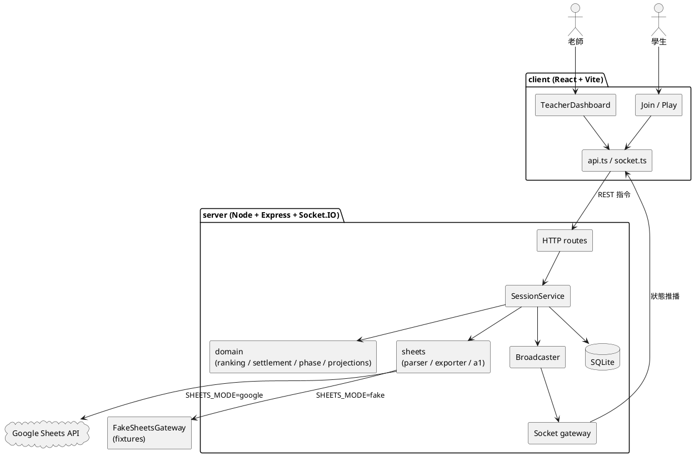
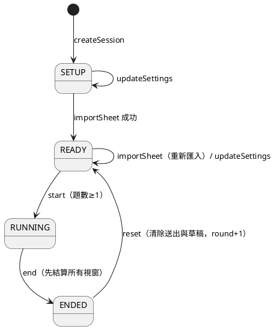
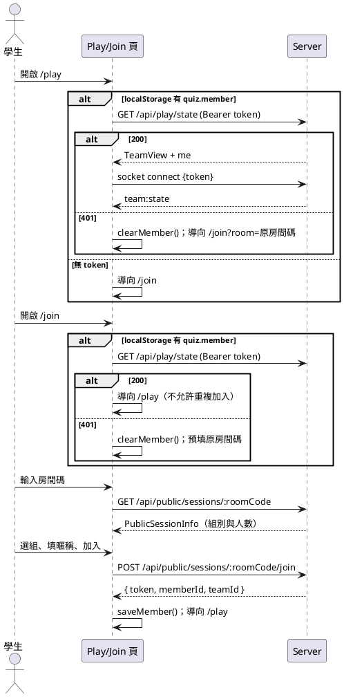
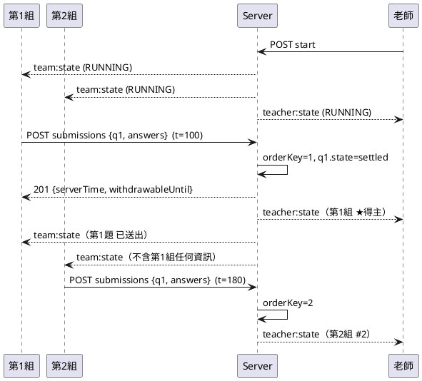
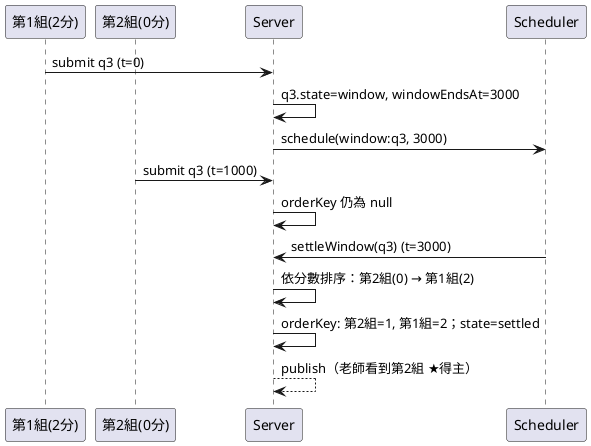
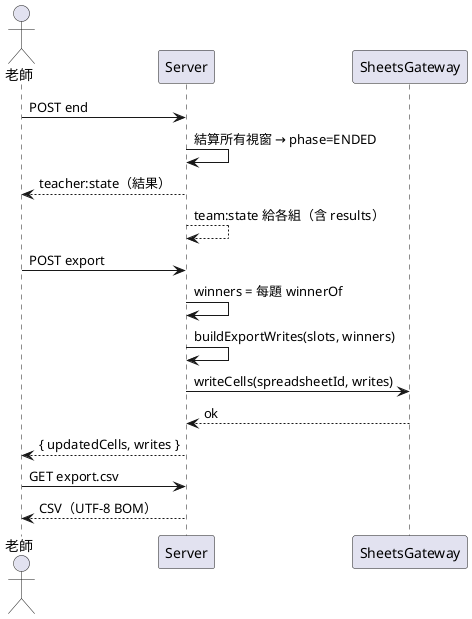

# 技術規格（TECH_SPEC）：Vibe Coding 課堂搶答系統

| 項目 | 內容 |
| --- | --- |
| 版本 | v1.6（2026-11-13：§7.8 SessionAggregate 新增 importSummary，供 projectTeacherView 輸出匯入摘要（specs/002 plan D9）；v1.5：fakeGateway 讀檔規則改為去掉 `fixture-` 前綴，對應 fixtures/sheets 實際檔名（specs/002 plan D1）；前版 v1.4：同步 PRD v1.2——匯入摘要文字固定格式、匯入進行中按鈕停用；v1.3：同步 PRD v1.1——老師登出、系統只有一個活動、已加入學生開 /join 直接回 /play、暱稱字元限制） |
| 需求來源 | `docs/PRD.md`（FR-01～FR-12、E1～E5、E7） |
| 測試規範 | `docs/TEST_SPEC.md` |
| 讀者 | 實作 agent（主要）、測試 agent、組員 |

---

## 0. 給實作 agent 的規則（必讀）

1. 依 §14.1 的子功能順序（001 → 004）實作；每個子功能只實作該列的範圍，該列的測試必須全部通過才能合併。§14 的里程碑表說明模組的層次關係，僅供參考。
2. 本文件中的**型別、函式簽名、API 路徑、事件名稱、錯誤碼、`data-testid`** 是介面契約，測試 agent 依此撰寫測試，不得自行改名。若必須改，先改本文件並註明原因。
3. 所有業務邏輯放在 `server/src/domain`、`server/src/sheets`、`server/src/services`，以**純函式或注入依賴**撰寫；HTTP 與 Socket 層只做轉換，不寫業務規則。
4. 時間一律透過 `Clock` 取得，計時一律透過 `Scheduler`，ID 一律透過 `IdGen`；禁止在 domain／service 中直接呼叫 `Date.now()`、`setTimeout`、`Math.random()`。
5. 禁止寫死任何試算表儲存格位址；寫回位置只能來自解析結果（FR-06）。
6. 學生端收到的任何資料都必須經過 `projectTeamView()`；禁止把 `TeacherView` 或其他組資料送到組別 room（FR-10）。
7. 不得把 `.env`、`secrets/`、`data/` 提交進 git。
8. 每完成一個功能，同步更新 `README.md` 的「功能清單」與「如何執行」。

---

## 1. 系統架構



設計原則：

- **指令走 REST，狀態走 Socket**：所有寫入動作都是 REST 請求；伺服器在每次狀態改變後，以 Socket.IO 推送「完整快照」給有權看到的人。客戶端不做增量合併，直接以快照取代本地狀態。
- **伺服器為唯一真相來源**：Node 單執行緒 + `node:sqlite` 同步交易，送出處理在同一個同步函式內完成，不會發生兩位得主的競態。
- **得主、順位、分數皆為衍生值**：由 `ranking.ts` 的純函式從送出紀錄計算，不另存，避免不一致。

---

## 2. 專案結構

```
/
├─ package.json                # npm workspaces: shared, server, client, e2e
├─ tsconfig.base.json
├─ .env.example
├─ .gitignore                  # .env, secrets/, data/, node_modules/, dist/, coverage/
├─ README.md
├─ docs/  PRD.md  TECH_SPEC.md  TEST_SPEC.md  manual-test.md
├─ diagrams/                   # *.puml 與輸出 PNG（SpecKit 組必備）
├─ fixtures/sheets/
│   ├─ template-a.xlsx  template-a.snapshot.json  template-a.expected.json
│   └─ template-b.xlsx  template-b.snapshot.json  template-b.expected.json
├─ shared/src/
│   ├─ types.ts                # §4 全部型別
│   ├─ errors.ts               # ErrorCode、AppError、HTTP 對照
│   ├─ constants.ts            # 常數（§3.3）
│   └─ validation.ts           # 暱稱、答案、房間碼驗證
├─ server/src/
│   ├─ index.ts                # 讀 config、組裝依賴、啟動、recover
│   ├─ app.ts                  # createApp(deps) → { app, httpServer, io }
│   ├─ config.ts
│   ├─ ports/  clock.ts  scheduler.ts  ids.ts  sheetsGateway.ts
│   ├─ sheets/ a1.ts  parser.ts  exporter.ts  googleGateway.ts  fakeGateway.ts
│   ├─ export/ csv.ts
│   ├─ domain/ phase.ts  ranking.ts  settlement.ts  projections.ts
│   ├─ db/     schema.sql  db.ts  repo.ts
│   ├─ services/ sessionService.ts  authService.ts
│   ├─ http/   teacherRoutes.ts  publicRoutes.ts  playRoutes.ts  devRoutes.ts  auth.ts  errorHandler.ts
│   ├─ realtime/ socket.ts  broadcaster.ts
│   └─ boot/   recover.ts
├─ server/test/                # 與 src 同結構的 *.test.ts，helpers/ 放 fakes
├─ client/src/
│   ├─ main.tsx  App.tsx  api.ts  socket.ts  storage.ts  messages.ts  format.ts
│   ├─ hooks/  useTeacher.ts  usePlay.ts  useServerClock.ts
│   ├─ pages/  Home.tsx  TeacherLogin.tsx  TeacherDashboard.tsx  Join.tsx  Play.tsx
│   └─ components/ （§10.4）
├─ client/test/                # Vitest + React Testing Library
└─ e2e/  playwright.config.ts  tests/*.spec.ts
```

---

## 3. 技術棧、指令與設定

### 3.1 版本

| 項目 | 版本 |
| --- | --- |
| Node.js | 22.13 以上（`node:sqlite` 免旗標可用） |
| TypeScript | 5.x，`strict: true` |
| 前端 | React 18、Vite 5、React Router 6 |
| 後端 | Express 4、Socket.IO 4、`node:sqlite`（Node 內建，`DatabaseSync`）、googleapis、zod（請求驗證） |
| 測試 | Vitest 2（含 coverage-v8）、@testing-library/react、supertest、socket.io-client、Playwright |

### 3.2 npm scripts（根目錄）

| 指令 | 作用 |
| --- | --- |
| `npm run dev` | 同時啟動 server（:3000，tsx watch）與 client（:5173，Vite proxy `/api`、`/socket.io` → 3000） |
| `npm run build` | 建置 shared、server、client |
| `npm start` | 以建置結果啟動 server，並由 server 提供 client 靜態檔（:3000） |
| `npm test` | 執行 shared、server、client 全部 unit／integration 測試 |
| `npm run test:coverage` | 同上並產生覆蓋率報告，未達門檻則失敗（見 TEST_SPEC §2.3） |
| `npm run test:e2e` | 以 `SHEETS_MODE=fake`、暫存 DB 啟動 server 並執行 Playwright |
| `npm run lint` | ESLint + `tsc --noEmit` |

### 3.3 常數（`shared/src/constants.ts`）

```ts
export const DEFAULT_TEAM_COUNT = 6;
export const MIN_TEAM_COUNT = 2;
export const MAX_TEAM_COUNT = 20;
export const DEFAULT_FAIRNESS_MODE: FairnessMode = 'fair';
export const DEFAULT_WINDOW_SEC = 3;
export const MIN_WINDOW_SEC = 1;
export const MAX_WINDOW_SEC = 10;
export const WITHDRAW_LIMIT_MS = 10_000;
export const MAX_ANSWER_LENGTH = 200;
export const MAX_NICKNAME_LENGTH = 20;
export const NICKNAME_PATTERN = /^[\u3400-\u4DBF\u4E00-\u9FFFA-Za-z0-9]+$/; // 中文字（基本平面＋擴充 A）、英文字母、數字
export const ROOM_CODE_LENGTH = 6;
export const ROOM_CODE_ALPHABET = 'ABCDEFGHJKLMNPQRSTUVWXYZ23456789'; // 去除 I O 0 1
export const DRAFT_DEBOUNCE_MS = 300;
```

### 3.4 環境變數（`.env.example`）

```dotenv
PORT=3000
TEACHER_PASSWORD=change-me
DB_PATH=./data/quiz.db
# google | fake
SHEETS_MODE=fake
GOOGLE_APPLICATION_CREDENTIALS=./secrets/service-account.json
# fake 模式讀取 fixture 的資料夾
FAKE_SHEETS_DIR=./fixtures/sheets
```

`config.ts` 必須在啟動時驗證：`TEACHER_PASSWORD` 非空；`SHEETS_MODE=google` 時金鑰檔存在，否則以清楚訊息結束程序。

---

## 4. 共用型別（`shared/src/types.ts`）

以下為契約，欄位名稱不得更改。

```ts
// ---------- 列舉 ----------
export type Phase = 'SETUP' | 'READY' | 'RUNNING' | 'ENDED';
export type FairnessMode = 'speed' | 'fair';
export type SubmissionStatus = 'active' | 'withdrawn' | 'rejected';
export type QuestionState = 'open' | 'window' | 'settled';

// ---------- 試算表 ----------
export interface GridRange {            // 與 Google Sheets API 相同：0-based，end 不含
  sheetId: number;
  startRowIndex: number; endRowIndex: number;
  startColumnIndex: number; endColumnIndex: number;
}
export interface SheetData {
  sheetId: number;
  title: string;
  values: string[][];                   // 以 A1 為原點（values[0][0] = A1），缺格視為 ''
  merges: GridRange[];
}
export interface SheetSnapshot { spreadsheetId: string; sheets: SheetData[]; }

export interface ParsedSlot {
  subNo: number;                        // 單題為 1
  sheetTitle: string;
  row: number; col: number;             // 0-based
  a1: string;                           // 例：'G5'
  prefix: string;                       // 例：'（1）'；單題通常為 ''
  originalValue: string;                // 匯入時作答格原值
}
export interface ParsedQuestion { number: number; isGroup: boolean; slots: ParsedSlot[]; }
export type ParseWarningCode = 'NON_CONSECUTIVE_NUMBERS' | 'SUBNO_MISMATCH';
export interface ParseWarning { code: ParseWarningCode; message: string; questionNumber?: number; }
export interface ParseResult {
  sheetTitle: string; headerRow: number; numberCol: number; answerCol: number;
  questions: ParsedQuestion[];
  warnings: ParseWarning[];
}
export interface CellWrite { sheetTitle: string; a1: string; value: string; }

// ---------- 實體 ----------
export interface Session {
  id: string; roomCode: string; phase: Phase;
  spreadsheetId: string | null; sheetTitle: string | null;
  fairnessMode: FairnessMode; windowSec: number; teamCount: number;
  round: number;                        // 每次 reset +1，從 1 開始
  createdAt: number; startedAt: number | null; endedAt: number | null;
}
export interface Question {
  id: string; sessionId: string; number: number; isGroup: boolean; subCount: number;
  state: QuestionState; windowEndsAt: number | null;
}
export interface AnswerSlot {
  id: string; questionId: string; subNo: number;
  sheetTitle: string; row: number; col: number; a1: string; prefix: string; originalValue: string;
}
export interface Team { id: string; sessionId: string; index: number; name: string; } // name = `第 ${index} 組`
export interface Member {
  id: string; teamId: string; nickname: string; token: string; joinedAt: number; lastSeenAt: number;
}
export interface Draft {
  teamId: string; questionId: string; answers: string[]; updatedBy: string; updatedAt: number;
}
export interface Submission {
  id: string; sessionId: string; questionId: string; teamId: string; memberId: string;
  answers: string[];                    // 長度 = subCount，已 trim
  serverTime: number; seq: number;      // seq：全域遞增，同毫秒時決定先後
  status: SubmissionStatus;
  orderKey: number | null;              // 結算後的名次鍵；視窗中為 null
  withdrawnAt: number | null;
}

// ---------- 衍生值 ----------
export interface RankedSubmission extends Submission { rank: number; isWinner: boolean; }

// ---------- 給客戶端的視圖 ----------
export interface QuestionInfo { id: string; number: number; isGroup: boolean; subCount: number; subLabels: string[]; }
// subLabels：題組為 ['（1）','（2）']（取 prefix，沒有則 `（${subNo}）`）；單題為 ['']

export interface TeacherCell {
  questionId: string; teamId: string;
  submission: null | {
    id: string; answers: string[]; submittedBy: string; serverTime: number;
    status: SubmissionStatus; rank: number | null; isWinner: boolean;
  };
}
export interface TeacherView {
  session: Session;
  questions: (QuestionInfo & { state: QuestionState; windowEndsAt: number | null; winnerTeamId: string | null })[];
  teams: (Team & { score: number; members: { id: string; nickname: string; online: boolean }[] })[];
  cells: TeacherCell[];                 // 每題 × 每組一格；同組同題多筆時取最新一筆
  importSummary: ImportSummary | null;
  serverNow: number;
}
export interface ImportSummary {
  questionCount: number; groupCount: number; singleCount: number; subQuestionCount: number;
  warnings: ParseWarning[];
}

export interface TeamView {               // 只送到該組 room；絕不含他組資料
  session: { roomCode: string; phase: Phase; round: number };
  team: { id: string; name: string; members: { id: string; nickname: string; online: boolean }[] };
  questions: QuestionInfo[];
  drafts: Record<string, { answers: string[]; updatedBy: string; updatedAt: number }>; // key = questionId
  mySubmissions: Record<string, {     // key = questionId；只含本組最新一筆
    id: string; answers: string[]; submittedBy: string; serverTime: number;
    status: SubmissionStatus; withdrawableUntil: number | null; // status=active 時 = serverTime + 10000
  }>;
  results: Results | null;              // 只有 phase = ENDED 時非 null
  serverNow: number;
}
export interface Results {
  questions: {
    questionId: string; number: number; isGroup: boolean; subLabels: string[];
    winner: null | { teamId: string; teamName: string; answers: string[]; submittedBy: string };
    ranking: { rank: number; teamId: string; teamName: string; answers: string[];
               submittedBy: string; serverTime: number; status: 'active' | 'rejected'; isWinner: boolean }[];
  }[];
  scores: { teamId: string; teamName: string; score: number }[]; // 依分數降冪、組序升冪
}
export interface PublicSessionInfo {
  roomCode: string; phase: Phase; teams: { id: string; name: string; memberCount: number }[];
}
```

**FR-10 的強制約束**：`TeamView` 在 `phase !== 'ENDED'` 時，不得包含任何 `rank`、`isWinner`、分數、他組名稱以外的他組資訊、題目 `state`／`windowEndsAt`。`QuestionInfo` 刻意不含狀態欄位。

---

## 5. 資料庫（`server/src/db/schema.sql`）

```sql
PRAGMA journal_mode = WAL;
PRAGMA foreign_keys = ON;

CREATE TABLE IF NOT EXISTS sessions (
  id TEXT PRIMARY KEY, room_code TEXT NOT NULL UNIQUE, phase TEXT NOT NULL,
  spreadsheet_id TEXT, sheet_title TEXT,
  fairness_mode TEXT NOT NULL, window_sec INTEGER NOT NULL, team_count INTEGER NOT NULL,
  round INTEGER NOT NULL DEFAULT 1,
  created_at INTEGER NOT NULL, started_at INTEGER, ended_at INTEGER,
  import_summary TEXT                    -- JSON
);
CREATE TABLE IF NOT EXISTS questions (
  id TEXT PRIMARY KEY, session_id TEXT NOT NULL REFERENCES sessions(id) ON DELETE CASCADE,
  number INTEGER NOT NULL, is_group INTEGER NOT NULL, sub_count INTEGER NOT NULL,
  state TEXT NOT NULL DEFAULT 'open', window_ends_at INTEGER,
  UNIQUE(session_id, number)
);
CREATE TABLE IF NOT EXISTS answer_slots (
  id TEXT PRIMARY KEY, question_id TEXT NOT NULL REFERENCES questions(id) ON DELETE CASCADE,
  sub_no INTEGER NOT NULL, sheet_title TEXT NOT NULL, row INTEGER NOT NULL, col INTEGER NOT NULL,
  a1 TEXT NOT NULL, prefix TEXT NOT NULL, original_value TEXT NOT NULL
);
CREATE TABLE IF NOT EXISTS teams (
  id TEXT PRIMARY KEY, session_id TEXT NOT NULL REFERENCES sessions(id) ON DELETE CASCADE,
  idx INTEGER NOT NULL, name TEXT NOT NULL, UNIQUE(session_id, idx)
);
CREATE TABLE IF NOT EXISTS members (
  id TEXT PRIMARY KEY, team_id TEXT NOT NULL REFERENCES teams(id) ON DELETE CASCADE,
  nickname TEXT NOT NULL, nickname_key TEXT NOT NULL, token TEXT NOT NULL UNIQUE,
  joined_at INTEGER NOT NULL, last_seen_at INTEGER NOT NULL,
  UNIQUE(team_id, nickname_key)          -- nickname_key = lower(trim(nickname))
);
CREATE TABLE IF NOT EXISTS drafts (
  team_id TEXT NOT NULL REFERENCES teams(id) ON DELETE CASCADE,
  question_id TEXT NOT NULL REFERENCES questions(id) ON DELETE CASCADE,
  answers TEXT NOT NULL, updated_by TEXT NOT NULL, updated_at INTEGER NOT NULL,
  PRIMARY KEY (team_id, question_id)
);
CREATE TABLE IF NOT EXISTS submissions (
  id TEXT PRIMARY KEY, session_id TEXT NOT NULL REFERENCES sessions(id) ON DELETE CASCADE,
  question_id TEXT NOT NULL REFERENCES questions(id) ON DELETE CASCADE,
  team_id TEXT NOT NULL REFERENCES teams(id) ON DELETE CASCADE,
  member_id TEXT NOT NULL REFERENCES members(id),
  answers TEXT NOT NULL, server_time INTEGER NOT NULL, seq INTEGER NOT NULL UNIQUE,
  status TEXT NOT NULL, order_key INTEGER, withdrawn_at INTEGER
);
CREATE INDEX IF NOT EXISTS idx_sub_q ON submissions(question_id);
-- 每組每題最多一筆 active 或 rejected（FR-08）
CREATE UNIQUE INDEX IF NOT EXISTS uq_sub_team_q_live
  ON submissions(team_id, question_id) WHERE status IN ('active','rejected');
```

> **為什麼不用 better-sqlite3**：開發機啟用了 Windows「智慧型應用程式控制」，它會擋下 better-sqlite3 未簽章的原生模組（`win32-x64.node`）。`node:sqlite` 由已簽章的 `node.exe` 直接提供，不需要任何原生模組。禁止加入任何需要 `.node` 原生模組的套件。

```ts
// server/src/db/db.ts
import { DatabaseSync } from 'node:sqlite';
export type Db = DatabaseSync;
export function openDb(path: string): Db;               // 開啟後執行 schema.sql；path 可為 ':memory:'
export function withTransaction<T>(db: Db, fn: () => T): T;
```

`node:sqlite` 注意事項：查詢結果是 null-prototype 物件（測試用 `toEqual` 比對，不用 `toStrictEqual`）；預設不回傳 BigInt（epoch 毫秒在安全整數範圍內）；具名參數使用 `$name` 寫法。

`repo.ts` 提供型別化的 CRUD（回傳 §4 實體，JSON 欄位自動 parse）。所有多步驟寫入必須包在 `db.ts` 提供的 `withTransaction(db, fn)`（內部以 `BEGIN IMMEDIATE`／`COMMIT`，例外時 `ROLLBACK` 後重新丟出）。`seq` 由 `SELECT COALESCE(MAX(seq),0)+1` 於交易內取得。

---

## 6. 階段狀態機（`domain/phase.ts`）



```ts
export type Action = 'import' | 'updateSettings' | 'start' | 'end' | 'reset'
  | 'draft' | 'submit' | 'withdraw' | 'rejectWinner' | 'export' | 'restore' | 'csv' | 'join';
export function assertPhase(phase: Phase, action: Action): void;   // 不允許時 throw AppError('INVALID_PHASE')
export function nextPhase(phase: Phase, action: 'import' | 'start' | 'end' | 'reset'): Phase;
```

| 動作 | 允許階段 |
| --- | --- |
| import | SETUP、READY |
| updateSettings | SETUP、READY |
| start | READY |
| end | RUNNING |
| reset | ENDED |
| draft、submit、withdraw | RUNNING |
| rejectWinner | RUNNING、ENDED |
| export、csv | ENDED |
| restore | READY、ENDED |
| join | 全部 |

---

## 7. 伺服器模組規格

### 7.1 依賴介面（`server/src/ports`）

```ts
export interface Clock { now(): number; }                       // 毫秒
export const systemClock: Clock;

export interface Scheduler {
  schedule(key: string, at: number, fn: () => void): void;      // 同 key 重複排程時取代舊的
  cancel(key: string): void;
  cancelAll(): void;
}
export const timerScheduler: (clock: Clock) => Scheduler;       // setTimeout(max(0, at - clock.now()))

export interface IdGen { id(prefix: 'ses' | 'q' | 'slot' | 'team' | 'mem' | 'sub'): string; token(): string; roomCode(): string; }
export const cryptoIdGen: IdGen;                                 // crypto.randomUUID / randomBytes

export interface SheetsGateway {
  fetchSnapshot(spreadsheetId: string): Promise<SheetSnapshot>;
  writeCells(spreadsheetId: string, writes: CellWrite[]): Promise<void>;
}
```

測試用實作（放 `server/test/helpers`，規格見 TEST_SPEC §3）：`FakeClock`、`ManualScheduler`、`SeqIdGen`、`InMemorySheetsGateway`。

### 7.2 `sheets/a1.ts`

```ts
export function colToLetters(col: number): string;              // 0→'A', 25→'Z', 26→'AA'
export function toA1(row: number, col: number): string;          // (4,6)→'G5'
export function quoteSheet(title: string): string;              // 學習單 → "'學習單'"；含 ' 時改為 ''
export function rangeA1(sheetTitle: string, a1: string): string; // "'學習單'!G5"
export function parseSpreadsheetInput(input: string): string;
// 1) 含 /spreadsheets/d/{id} 的網址 → id
// 2) 符合 /^[A-Za-z0-9_-]{10,}$/ 的字串 → 原樣
// 3) 其他 → throw AppError('INVALID_SPREADSHEET_URL')
```

### 7.3 `sheets/parser.ts`（FR-01、FR-02、E1）

```ts
export function parseGuidedNotes(snapshot: SheetSnapshot): ParseResult;
```

演算法（必須逐條實作）：

1. 依 `snapshot.sheets` 順序找第一個有表頭的工作表：某列中同時存在 `trim(cell) === '題號'` 與 `trim(cell) === '作答'`。記錄 `headerRow`、`numberCol`、`answerCol`（若有多個符合儲存格取最左邊）。全部工作表都找不到 → `throw AppError('HEADER_NOT_FOUND')`。
2. 從 `headerRow + 1` 掃到 `values.length - 1`，令 `raw = trim(values[r][numberCol] ?? '')`。
3. `raw` 符合 `/^\d+(\.0+)?$/` → 題目起點，`number = parseInt(raw)`；否則跳過該列。
4. 找出包含 `(r, numberCol)` 的 merge：`start ≤ r < end`（列與欄皆判斷）。有且跨列數 `n = endRowIndex - startRowIndex > 1` → 題組，子題列為 `startRowIndex … endRowIndex-1`；否則單題，列為 `[r]`。
5. **後備規則（merge 遺失時）**：單題且作答格前綴為「（1）」時，向下吸收連續的列，條件為「題號欄空白且作答格前綴為（k）、k 依序遞增」；吸收到 ≥ 2 列時視為題組。
6. 每個子題列建立 `ParsedSlot`：`originalValue = values[row][answerCol] ?? ''`；前綴正規式 `/^\s*[（(]\s*(\d+)\s*[）)]/`，符合時 `prefix = match[0]`、`subNo = Number(match[1])`；不符合時 `prefix = ''`、`subNo = 列序（從 1）`。單題 `subNo = 1`。
7. 題組子題的 `subNo` 不是 1..n 遞增時，新增 `SUBNO_MISMATCH` 警告，並把 `subNo` 改為列序 1..n。
8. 下一個掃描列 = 題組最後一列 + 1。
9. 結束後：題目數為 0 → `NO_QUESTIONS`；題號重複 → `DUPLICATE_QUESTION_NUMBER`（message 含重複題號）；題號排序後不是 `1..N` 連續 → `NON_CONSECUTIVE_NUMBERS` 警告（不阻擋）。
10. `questions` 依題號升冪排序後回傳。

範例 A 期望輸出見 `fixtures/sheets/template-a.expected.json`：第 1 題（G5、G6）、第 2 題（G8、G9）為題組，第 3 題（G11）、第 4 題（G13）為單題。範例 B：第 1～6 題皆單題，作答格 G5、G7、G9、G11、G13、G15。

```ts
export function summarize(result: ParseResult): ImportSummary;
// questionCount=題數；groupCount=isGroup 數；singleCount=非題組數；subQuestionCount=題組子題總數
```

### 7.4 `sheets/exporter.ts`（FR-06）

```ts
export function buildExportWrites(
  slots: AnswerSlot[], questions: Question[], winners: Map<string, Submission> // key = questionId
): CellWrite[];
// 對每個有得主的題目、每個 slot（依 subNo）：value = slot.prefix + winner.answers[subNo-1]
// 無得主的題目不產生寫入；輸出依 sheetTitle、row、col 排序
export function buildRestoreWrites(slots: AnswerSlot[]): CellWrite[]; // value = originalValue
```

`googleGateway.ts`：

- 匯出 `createGoogleGateway(client: sheets_v4.Sheets): SheetsGateway`（client 由 `index.ts` 以服務帳號建立後注入，方便測試替換）。
- `fetchSnapshot`：`spreadsheets.get({ spreadsheetId, fields: 'sheets(properties(sheetId,title),merges)' })`，再 `spreadsheets.values.batchGet({ ranges: 每個工作表 quoteSheet(title), valueRenderOption: 'FORMATTED_VALUE' })`。依回傳 `range` 的起始儲存格把 values 補齊成以 A1 為原點。
- `writeCells`：`spreadsheets.values.batchUpdate({ valueInputOption: 'RAW', data: writes.map(w => ({ range: rangeA1(w.sheetTitle, w.a1), values: [[w.value]] })) })`。
- 錯誤對照：HTTP 403 → `SHEETS_PERMISSION_DENIED`；404 → `SHEETS_NOT_FOUND`；其他 → `SHEETS_ERROR`。
- Scope：`https://www.googleapis.com/auth/spreadsheets`。

`fakeGateway.ts`（`SHEETS_MODE=fake`）：

- `fetchSnapshot(id)`：id 必須以 `fixture-` 開頭且去掉前綴後的名稱符合 `/^[A-Za-z0-9_-]+$/`，讀取 `${FAKE_SHEETS_DIR}/${名稱}.snapshot.json`（例：`fixture-template-a` → `template-a.snapshot.json`）；不符合或檔案不存在 → `SHEETS_NOT_FOUND`。之後以記憶體中的副本為準。
- `writeCells` 修改記憶體副本，並寫到 `data/fake-sheets/${id}.json` 方便檢查。
- 提供 `getSnapshot(id)` 給 `devRoutes`（§8.4）。

### 7.5 `export/csv.ts`（E2）

```ts
export function buildResultsCsv(rows: CsvRow[]): string;
export interface CsvRow {
  questionNumber: number; subNo: number; teamName: string; submittedBy: string; answer: string;
  serverTime: number; rank: number | null; status: SubmissionStatus; isWinner: boolean;
}
```

- 開頭 UTF-8 BOM ``；換行 `\r\n`；最後一列後也有 `\r\n`。
- 表頭固定：`題號,子題,組別,送出者,答案,伺服器時間,順位,狀態,是否得主`。
- 伺服器時間格式：`YYYY-MM-DDTHH:mm:ss.SSS+08:00`（Asia/Taipei）。
- 狀態文字：active→`有效`、withdrawn→`已撤回`、rejected→`判錯`；是否得主：`是`／`否`；rank 為 null → 空字串。
- RFC 4180 跳脫：含 `,`、`"`、`\r`、`\n` 的欄位以雙引號包住，內部 `"` 改為 `""`。
- 防公式注入：欄位開頭為 `=`、`+`、`-`、`@` 時前面加 `'`。
- 列順序：題號升冪 → 順位升冪（null 最後，再依 serverTime）→ 子題升冪。包含所有送出（含撤回）。

### 7.6 `domain/ranking.ts`（衍生值，FR-05、FR-11、E5）

```ts
export function orderSubmissions(subs: Submission[]): Submission[];
// 排除 withdrawn；依 orderKey 升冪（null 排最後）→ serverTime → seq
export function rankSubmissions(subs: Submission[]): RankedSubmission[];
// rank = orderSubmissions 中的位置 + 1；isWinner = 為第一筆 status='active' 且 orderKey !== null 者
export function winnerOf(subs: Submission[]): Submission | null;
export function teamScores(teams: Team[], subsByQuestion: Map<string, Submission[]>): Map<string, number>;
// 每題 winnerOf 的 teamId +1；沒有得分的組為 0
```

> 判錯（rejected）的送出保留名次但不能是得主；撤回（withdrawn）的送出不列入名次。因此「遞補」與「扣分」自動成立，不需額外狀態。

### 7.7 `domain/settlement.ts`（FR-11、E3）

```ts
export function sortFairCandidates(cands: Submission[], scores: Map<string, number>): Submission[];
// 依 (scores.get(teamId) ?? 0) 升冪 → serverTime 升冪 → seq 升冪
export function assignOrderKeys(sorted: Submission[], startAt: number): Map<string, number>; // id → startAt, startAt+1…
export function nextOrderKey(subs: Submission[]): number;   // max(orderKey)+1，沒有則 1
```

### 7.8 `domain/projections.ts`（FR-04、FR-05、FR-09、FR-10）

```ts
export interface SessionAggregate {
  session: Session; questions: Question[]; slots: AnswerSlot[]; teams: Team[];
  members: Member[]; drafts: Draft[]; submissions: Submission[]; onlineMemberIds: Set<string>;
  importSummary: ImportSummary | null;   // 讀自 sessions.import_summary（JSON）；未匯入為 null
}
export function questionInfo(q: Question, slots: AnswerSlot[]): QuestionInfo;
export function projectTeacherView(agg: SessionAggregate, now: number): TeacherView;
export function projectTeamView(agg: SessionAggregate, teamId: string, now: number): TeamView;
export function buildResults(agg: SessionAggregate): Results;
export function buildCsvRows(agg: SessionAggregate): CsvRow[];
```

`projectTeamView` 必須：

- 只從 `agg` 中取 `teamId` 相同的 members、drafts、submissions。
- `results` 只有 `session.phase === 'ENDED'` 時才呼叫 `buildResults`，其餘為 `null`。
- `mySubmissions[questionId]` 取本組該題最新一筆（`seq` 最大）；`withdrawableUntil = status==='active' ? serverTime + WITHDRAW_LIMIT_MS : null`。

### 7.9 `services/sessionService.ts`

```ts
export interface ServiceDeps {
  repo: Repo; clock: Clock; scheduler: Scheduler; ids: IdGen;
  sheets: SheetsGateway; broadcaster: Broadcaster;
}
export class SessionService {
  constructor(deps: ServiceDeps);
  // 老師
  createSession(input: { teamCount?: number; fairnessMode?: FairnessMode; windowSec?: number }): TeacherView;
  getCurrentSession(): TeacherView | null;            // 最新建立的活動
  getTeacherView(sessionId: string): TeacherView;
  updateSettings(sessionId: string, input: { teamCount?: number; fairnessMode?: FairnessMode; windowSec?: number }): TeacherView;
  importSheet(sessionId: string, spreadsheetInput: string): Promise<{ view: TeacherView; summary: ImportSummary }>;
  start(sessionId: string): TeacherView;
  end(sessionId: string): TeacherView;
  reset(sessionId: string): TeacherView;
  rejectWinner(sessionId: string, questionId: string): TeacherView;
  exportToSheet(sessionId: string): Promise<{ updatedCells: number; writes: CellWrite[] }>;
  restoreSheet(sessionId: string): Promise<{ updatedCells: number }>;
  exportCsv(sessionId: string): string;
  // 學生
  getPublicInfo(roomCode: string): PublicSessionInfo;
  join(roomCode: string, input: { teamId: string; nickname: string }): { token: string; memberId: string; teamId: string; sessionId: string };
  resolveMember(token: string): Member & { sessionId: string };   // 無效 → UNAUTHORIZED
  getTeamView(memberToken: string): TeamView;
  updateDraft(memberToken: string, questionId: string, answers: string[]): void;
  submit(memberToken: string, questionId: string, answers: string[]): { submissionId: string; serverTime: number; withdrawableUntil: number };
  withdraw(memberToken: string, submissionId: string): void;
  // 連線狀態
  setOnline(memberId: string, online: boolean): void;
  // 系統
  settleWindow(questionId: string): void;              // 由 Scheduler 呼叫
  recover(): void;                                     // 啟動時呼叫（§7.12）
}
```

每個會改變狀態的方法，成功後都必須呼叫 `broadcaster.publish(sessionId, scope)`（§9.3）。各方法的前置條件、效果與錯誤：

| 方法 | 前置條件 | 效果 | 錯誤 |
| --- | --- | --- | --- |
| createSession | teamCount ∈ [2,20]、windowSec ∈ [1,10]；未提供時用預設（6 組、fair、3 秒） | 建 session（phase=SETUP、round=1）與 N 組；`ids.roomCode()` 與既有活動重複時重抽，最多 10 次 | INVALID_INPUT |
| updateSettings | 階段允許；減少組數時被移除的組沒有成員 | 更新設定；增減 teams | INVALID_PHASE、INVALID_INPUT、TEAM_HAS_MEMBERS |
| importSheet | 階段允許 | `parseSpreadsheetInput` → `sheets.fetchSnapshot` → `parseGuidedNotes`；交易內刪除舊 questions／slots／drafts，寫入新的；存 spreadsheetId、sheetTitle、importSummary；phase=READY | INVALID_PHASE、INVALID_SPREADSHEET_URL、SHEETS_*、HEADER_NOT_FOUND、NO_QUESTIONS、DUPLICATE_QUESTION_NUMBER |
| start | phase=READY 且題數 ≥ 1 | phase=RUNNING、startedAt=now；所有題目 state=open | INVALID_PHASE、NO_QUESTIONS |
| end | phase=RUNNING | 依 (windowEndsAt, number) 順序對所有 state=window 的題目執行 settleWindow；`scheduler.cancel` 全部視窗；phase=ENDED、endedAt=now | INVALID_PHASE |
| reset | phase=ENDED | 刪 submissions、drafts；題目 state=open、windowEndsAt=null；round+1；phase=READY；startedAt、endedAt=null | INVALID_PHASE |
| rejectWinner | phase ∈ {RUNNING, ENDED}；該題有得主 | 得主 submission.status=rejected | INVALID_PHASE、QUESTION_NOT_FOUND、NO_WINNER |
| exportToSheet | phase=ENDED；有 spreadsheetId | `buildExportWrites` → `sheets.writeCells` | INVALID_PHASE、SHEETS_* |
| restoreSheet | phase ∈ {READY, ENDED} | `buildRestoreWrites` → `sheets.writeCells` | INVALID_PHASE、SHEETS_* |
| exportCsv | phase=ENDED | `buildResultsCsv(buildCsvRows(agg))` | INVALID_PHASE |
| join | roomCode 存在；teamId 屬於該活動；暱稱合法且組內不重複 | 建 member、發 token（32 bytes hex） | SESSION_NOT_FOUND、TEAM_NOT_FOUND、INVALID_NICKNAME、NICKNAME_TAKEN |
| updateDraft | phase=RUNNING；題目屬於該活動；answers 長度=subCount；每格 ≤200 字；本組該題無 active／rejected 送出 | upsert draft（不 trim）；只推播給本組 | INVALID_PHASE、QUESTION_NOT_FOUND、INVALID_INPUT、ANSWER_TOO_LONG、ALREADY_SUBMITTED |
| submit | 見下方 | 見下方 | 見下方 |
| withdraw | phase=RUNNING；submission 屬於本組；status=active；`now - serverTime ≤ 10000` | status=withdrawn、withdrawnAt=now；若題目 state=window 且已無 active 候選 → 該題 state=open、windowEndsAt=null、`scheduler.cancel` | INVALID_PHASE、SUBMISSION_NOT_FOUND、INVALID_STATE、WITHDRAW_WINDOW_EXPIRED |

**submit 演算法（FR-07、FR-08、FR-11、E1、E3）**，整段在單一同步交易中執行：

```
1. member = resolveMember(token)；session = member 所屬活動
2. assertPhase(session.phase, 'submit')                         → INVALID_PHASE
3. q = 題目（必須屬於該活動）                                     → QUESTION_NOT_FOUND
4. answers.length !== q.subCount                                → INVALID_INPUT
5. trimmed = answers.map(trim)
   任一為空 → q.isGroup ? GROUP_INCOMPLETE : ANSWER_REQUIRED
   任一長度 > 200                                               → ANSWER_TOO_LONG
6. 本組該題已有 status ∈ {active, rejected}                     → ALREADY_SUBMITTED
7. now = clock.now()；seq = 下一個序號
8. 依 q.state：
   a) session.fairnessMode === 'speed'：
        orderKey = nextOrderKey(該題全部送出)；q.state = 'settled'
   b) fair 且 q.state === 'open'：
        orderKey = null；q.state = 'window'；q.windowEndsAt = now + windowSec*1000
        scheduler.schedule(`window:${q.id}`, q.windowEndsAt, () => settleWindow(q.id))
   c) fair 且 q.state === 'window'：orderKey = null
   d) fair 且 q.state === 'settled'：orderKey = nextOrderKey(該題全部送出)
9. 新增 submission（status=active）；刪除本組該題 draft
10. 提交交易後 publish（全部）
11. 回傳 { submissionId, serverTime: now, withdrawableUntil: now + 10000 }
```

**settleWindow(questionId)**：

```
1. 讀題目；若 state !== 'window' 直接 return（冪等）
2. cands = 該題 status='active' 且 orderKey=null 的送出
3. cands 為空 → state='open'、windowEndsAt=null；publish；return
4. scores = teamScores(全部組, 目前全部題目的送出)        // 結算當下的分數
5. sorted = sortFairCandidates(cands, scores)
6. keys = assignOrderKeys(sorted, nextOrderKey(該題全部送出))
7. 寫入 orderKey；state='settled'；windowEndsAt=null
8. publish（全部）
```

注意：步驟 4 使用「其他已結算題目」的分數；同時結束的多個視窗依 `(windowEndsAt, number)` 順序結算，前一題的結果會影響後一題。

### 7.10 `services/authService.ts`

```ts
export class AuthService {
  constructor(password: string, ids: IdGen);
  login(password: string): string;          // 錯 → UNAUTHORIZED；對 → 新 teacher token（存記憶體 Set）
  verifyTeacher(token: string | undefined): void;   // 無效 → UNAUTHORIZED
}
```

比對密碼使用 `crypto.timingSafeEqual`（長度不同時直接失敗）。

### 7.11 `realtime/broadcaster.ts`、`realtime/socket.ts`

```ts
export interface PublishScope { teacher?: boolean; teamIds?: string[] | 'all'; }  // 預設 { teacher: true, teamIds: 'all' }
export interface Broadcaster { publish(sessionId: string, scope?: PublishScope): void; }
export function createSocketBroadcaster(io: Server, load: (sessionId: string) => SessionAggregate, clock: Clock): Broadcaster;
export const nullBroadcaster: Broadcaster;     // 單元測試用
```

- `publish` 時載入一次 aggregate：對 `teacher:${sessionId}` emit `teacher:state`（projectTeacherView）；對每個目標組 emit `team:state` 到 `team:${teamId}`（projectTeamView）。
- 連線驗證：`io.use` 讀 `socket.handshake.auth.token`。teacher token → 必須同時帶 `auth.sessionId`，加入 `teacher:${sessionId}`；member token → 加入 `team:${teamId}`，`setOnline(memberId, true)`；兩者皆非 → `next(new Error('UNAUTHORIZED'))`。
- 連線成功後立即對該 socket emit 一次目前狀態（E7）。
- 斷線時 member 的 online 改 false（同一 member 多分頁時，最後一個分頁斷線才算離線），並 publish。

### 7.12 `boot/recover.ts`（E7、可靠性）

啟動時對所有 `phase=RUNNING` 的活動、所有 `state=window` 的題目：`windowEndsAt ≤ now` → 立即 `settleWindow`；否則 `scheduler.schedule`。所有 member online 重設為 false（online 狀態只存記憶體）。

---

## 8. REST API

- Base：`/api`；JSON；時間皆為毫秒 epoch。
- 錯誤格式：`{ "error": { "code": ErrorCode, "message": string } }`，HTTP 狀態依 §11。
- 請求本文以 zod 驗證，失敗 → 422 `INVALID_INPUT`。
- 老師端：`Authorization: Bearer <teacherToken>`；學生端：`Authorization: Bearer <memberToken>`。

### 8.1 老師（`/api/teacher`）

| 方法 | 路徑 | 本文 | 成功回應 |
| --- | --- | --- | --- |
| POST | `/login` | `{ password }` | 200 `{ token }` |
| POST | `/sessions` | `{ teamCount?, fairnessMode?, windowSec? }` | 201 `TeacherView` |
| GET | `/sessions/current` | — | 200 `TeacherView`；沒有活動 → 404 `SESSION_NOT_FOUND` |
| GET | `/sessions/:id` | — | 200 `TeacherView` |
| PATCH | `/sessions/:id/settings` | `{ teamCount?, fairnessMode?, windowSec? }` | 200 `TeacherView` |
| POST | `/sessions/:id/import` | `{ spreadsheet: string }` | 200 `{ view, summary }` |
| POST | `/sessions/:id/start` | — | 200 `TeacherView` |
| POST | `/sessions/:id/end` | — | 200 `TeacherView` |
| POST | `/sessions/:id/reset` | — | 200 `TeacherView` |
| POST | `/sessions/:id/questions/:qid/reject-winner` | — | 200 `TeacherView` |
| POST | `/sessions/:id/export` | — | 200 `{ updatedCells, writes }` |
| POST | `/sessions/:id/restore` | — | 200 `{ updatedCells }` |
| GET | `/sessions/:id/export.csv` | — | 200 `text/csv; charset=utf-8`，`Content-Disposition: attachment; filename="results-<roomCode>-r<round>.csv"` |

### 8.2 公開（`/api/public`）

| 方法 | 路徑 | 本文 | 成功回應 |
| --- | --- | --- | --- |
| GET | `/sessions/:roomCode` | — | 200 `PublicSessionInfo`（roomCode 不分大小寫） |
| POST | `/sessions/:roomCode/join` | `{ teamId, nickname }` | 201 `{ token, memberId, teamId, sessionId }` |

### 8.3 學生（`/api/play`，需 member token）

| 方法 | 路徑 | 本文 | 成功回應 |
| --- | --- | --- | --- |
| GET | `/state` | — | 200 `TeamView & { me: { id, nickname } }` |
| PUT | `/drafts/:questionId` | `{ answers: string[] }` | 204 |
| POST | `/submissions` | `{ questionId, answers: string[] }` | 201 `{ submissionId, serverTime, withdrawableUntil }` |
| POST | `/submissions/:id/withdraw` | — | 204 |

### 8.4 開發用（只在 `SHEETS_MODE=fake` 時掛載）

| 方法 | 路徑 | 回應 |
| --- | --- | --- |
| GET | `/api/dev/fake-sheets/:spreadsheetId` | 200 目前記憶體中的 `SheetSnapshot`（E2E 驗證寫回用） |
| POST | `/api/dev/fake-sheets/:spreadsheetId/reset` | 204，重新從 fixture 載入 |

---

## 9. Socket.IO 契約

### 9.1 連線

```ts
// 老師
io('/', { auth: { token: teacherToken, sessionId } });
// 學生
io('/', { auth: { token: memberToken } });
```

驗證失敗時 `connect_error.message === 'UNAUTHORIZED'`，客戶端應清除 token 並導回登入／加入頁。

### 9.2 伺服器 → 客戶端事件

| 事件 | 接收者（room） | Payload | 時機 |
| --- | --- | --- | --- |
| `teacher:state` | `teacher:${sessionId}` | `TeacherView` | 連線成功時、任何狀態改變後 |
| `team:state` | `team:${teamId}` | `TeamView` | 連線成功時、會影響該組的狀態改變後 |

客戶端 → 伺服器：無（所有指令走 REST）。

### 9.3 推播範圍

| 觸發 | teacher | 組別 |
| --- | --- | --- |
| createSession、updateSettings、import、start、end、reset、rejectWinner、settleWindow、submit、withdraw | 是 | 全部 |
| join、上線／離線 | 是 | 該成員所屬組 |
| updateDraft | 否 | 該成員所屬組 |
| export、restore、csv | 否 | 否 |

> submit 推播到「全部組」是為了簡化，但每組收到的是自己的 `projectTeamView`，因此不會洩漏他組資料；測試會以封包檢查驗證（TEST_SPEC IT-VIS）。

---

## 10. 前端規格

### 10.1 路由

| 路徑 | 頁面 | 進入條件 |
| --- | --- | --- |
| `/` | Home：「我是老師」「我是學生」兩個按鈕 | — |
| `/teacher/login` | TeacherLogin | — |
| `/teacher` | TeacherDashboard | sessionStorage 有 teacher token，否則導向 `/teacher/login` |
| `/join` | Join；支援 `?room=ABC123` 預填 | localStorage 有 member token 時先 `GET /api/play/state`：200 → 導向 `/play`；401 → `clearMember()`，以原 roomCode 預填並顯示加入表單；無 token → 顯示加入表單 |
| `/play` | Play | localStorage 有 member token，否則導向 `/join` |

### 10.2 客戶端狀態與儲存（`storage.ts`）

| Key | 儲存位置 | 內容 |
| --- | --- | --- |
| `quiz.teacher` | sessionStorage | `{ token: string }` |
| `quiz.member` | localStorage | `{ token: string; roomCode: string; memberId: string }` |

```ts
export function loadMember(): { token: string; roomCode: string; memberId: string } | null; // JSON 壞掉 → 清除並回傳 null
export function saveMember(v: { token: string; roomCode: string; memberId: string }): void;
export function clearMember(): void;
export function loadTeacher(): { token: string } | null;
export function saveTeacher(v: { token: string }): void;
export function clearTeacher(): void;
```

所有 storage 讀寫必須 try/catch（無痕模式可能丟例外）。

### 10.3 Hooks

```ts
useTeacher(): {
  view: TeacherView | null; error: AppErrorView | null; busy: boolean;
  createSession(input): Promise<void>; updateSettings(input): Promise<void>;
  importSheet(spreadsheet: string): Promise<ImportSummary>;
  start(): Promise<void>; end(): Promise<void>; reset(): Promise<void>;
  rejectWinner(questionId: string): Promise<void>;
  exportToSheet(): Promise<number>; restoreSheet(): Promise<number>; downloadCsv(): Promise<void>;
}
usePlay(): {
  view: TeamView | null; me: { id: string; nickname: string } | null; error: AppErrorView | null;
  setDraft(questionId: string, answers: string[]): void;   // 立即更新本地，300 ms debounce 後 PUT
  submit(questionId: string): Promise<void>;               // 以目前草稿送出
  withdraw(submissionId: string): Promise<void>;
}
useServerClock(serverNow: number | undefined): () => number; // 回傳校正後的現在時間（offset = serverNow - Date.now()）
```

收到 `team:state` 時：若本地正在編輯某題且距上次本地輸入 < 1 秒，該題草稿保留本地值（避免游標跳動），其餘一律以伺服器快照取代。

### 10.4 元件與 `data-testid`（測試契約）

| 元件 | 用途 | 主要 `data-testid` |
| --- | --- | --- |
| `PhaseBadge` | 顯示階段 | `phase-badge`（文字：準備中／等待開始／搶答中／已結束） |
| `ErrorBanner` | 顯示錯誤訊息（`messages.ts` 對照） | `error-banner` |
| `LoginForm` | 老師登入 | `teacher-password`、`teacher-login-submit` |
| `TeacherDashboard`（頁面） | 建立活動（只在沒有活動時顯示）；登出（按下 → `clearTeacher()`、中斷 Socket、導向 `/teacher/login`；不呼叫伺服器） | `btn-create-session`、`teacher-logout` |
| `SettingsForm` | 組數、模式、視窗秒數 | `settings-team-count`、`settings-mode-speed`、`settings-mode-fair`、`settings-window-sec`、`settings-save` |
| `ImportForm` | 貼上網址並匯入；輸入為空白或 `useTeacher.busy` 為 true 時 `import-submit` disabled；匯入進行中按鈕文字為「匯入中…」 | `import-input`、`import-submit` |
| `ImportSummary` | 匯入結果；`import-summary` 文字固定為「偵測到 {questionCount} 題，其中 {groupCount} 題組（共 {subQuestionCount} 子題）、{singleCount} 單題」，下方依序列出警告與題號清單 | `import-summary`、`import-question-count`、`import-group-count`、`import-warning-{i}` |
| `RoomCode` | 大字顯示房間碼與加入網址 | `room-code` |
| `TeamList` | 各組成員與上線狀態 | `team-row-{index}`、`team-member-count-{index}` |
| `ControlBar` | 開始／結束／重新開始 | `btn-start`、`btn-end`、`btn-reset` |
| `StatusGrid` | 題目 × 組別即時狀態 | `status-grid`、`status-cell-{qNumber}-{teamIndex}`、`question-state-{qNumber}` |
| `ResultsTable` | 結果、判錯 | `results-table`、`result-winner-{qNumber}`、`btn-reject-{qNumber}`、`score-{teamIndex}` |
| `ExportPanel` | 寫回、還原、CSV | `btn-export-sheet`、`btn-restore-sheet`、`btn-download-csv`、`export-result` |
| `JoinForm` | 房間碼、組別、暱稱 | `join-room`、`join-room-next`、`join-team-{index}`、`join-nickname`、`join-submit` |
| `TeamHeader` | 學生頁頂部：組名、暱稱、組員 | `team-name`、`my-nickname`、`team-members` |
| `AnswerCard` | 單題或題組作答 | `answer-card-{qNumber}`、`answer-input-{qNumber}-{subNo}`、`btn-submit-{qNumber}`、`submitted-{qNumber}`、`btn-withdraw-{qNumber}`、`withdraw-countdown-{qNumber}` |
| `StudentResults` | 學生端結果 | `student-results`、`student-result-{qNumber}` |

`StatusCell` 顯示規則（老師端）：

| 狀態 | 顯示 |
| --- | --- |
| 無送出 | `—` |
| active、非得主 | 答案（題組以「（1）A／（2）B」）、送出者、`HH:mm:ss.SSS`、`#順位`（尚未結算顯示 `判定中`） |
| active、得主 | 同上並加 `★ 得主`，儲存格以強調色 |
| withdrawn | `已撤回`（灰字） |
| rejected | `✗ 判錯`（刪除線） |

題目欄標題在 `state=window` 時顯示 `判定中 x.x s`（以 useServerClock 倒數）。

`AnswerCard` 狀態（學生端）：

| 條件 | 輸入框 | 按鈕 |
| --- | --- | --- |
| phase ≠ RUNNING | disabled，placeholder「等待老師開始」 | 送出 disabled |
| RUNNING、未送出 | 可編輯（草稿同步） | 送出：任一子題空白時 disabled |
| RUNNING、active、未滿 10 秒 | disabled，顯示已送出答案 | 「撤回（n 秒）」倒數；歸零後隱藏 |
| RUNNING、active、超過 10 秒 | disabled | 只顯示「已送出 HH:mm:ss」 |
| RUNNING、withdrawn | 可編輯（以撤回的答案為初始值） | 送出 |
| RUNNING、rejected | disabled | 顯示「老師判定此答案錯誤」（只涉及本組資料，不違反 FR-10）；不可重送 |
| ENDED | 隱藏，改顯示 StudentResults | — |

> RUNNING 中學生端只能看到「已送出」，不顯示是否為得主或順位（FR-10）。

### 10.5 畫面線框

**老師：設定與匯入（SETUP／READY）**

```
┌──────────────────────────────────────────────────────────────┐
│ 課堂搶答 · 老師端                         [準備中]  房間碼 K7Q2MX │
├──────────────────────────────────────────────────────────────┤
│ 活動設定  組數 [ 6 ▾]   判定模式 (●)公平 ( )純速度   視窗 [3] 秒  [儲存] │
│ 匯入 Guided Notes                                               │
│ [ https://docs.google.com/spreadsheets/d/...              ] [匯入] │
│ ✔ 偵測到 4 題，其中 2 題組（共 4 子題）、2 單題                      │
│   第1題 題組（1）（2） 第2題 題組（1）（2） 第3題 第4題                │
├──────────────────────────────────────────────────────────────┤
│ 組別  第1組 ●小明 ●小華   第2組 ●阿傑   第3組 (無人) …              │
│                                              [ 開始搶答 ]        │
└──────────────────────────────────────────────────────────────┘
```

**老師：搶答中（RUNNING）**

```
┌───────────── 搶答中 ─────────────────────────────── [結束搶答] ┐
│        │ 第1題 判定中1.8s │ 第2題          │ 第3題   │ 第4題 │
│ 第1組  │ （1）CPU／（2）OS │ —              │ 0 ★得主 │ —     │
│        │ 小明 14:03:05.120 │                │ #1      │       │
│ 第2組  │ （1）CPU／（2）作業系統│ （1）演算法…★│ 1 #2    │ —     │
│ 第3組  │ —                │ 已撤回          │ —       │ —     │
└────────────────────────────────────────────────────────────┘
```

**老師：結果（ENDED）**

```
┌──────── 已結束 ────────────────────────────────────────────┐
│ 題號 │ 得主  │ 答案                  │ 各組順位            │ 操作  │
│ 1    │ 第2組 │ （1）CPU（2）作業系統   │ 1.第2組 2.第1組      │[判錯] │
│ 3    │ 第1組 │ 0                     │ 1.第1組 2.第2組      │[判錯] │
│ 分數：第1組 1　第2組 2　第3組 0                                  │
│ [寫回 Google Sheets] [還原原始內容] [下載 CSV] [重新開始一輪]       │
└──────────────────────────────────────────────────────────┘
```

**學生：加入**

```
┌──────── 加入搶答 ────────┐
│ 房間碼 [K7Q2MX] [下一步]   │
│ 選擇組別                  │
│ (第1組 2人) (第2組 1人) … │
│ 暱稱 [小明        ]       │
│ [ 加入 ]                 │
└─────────────────────────┘
```

**學生：作答（RUNNING）**

```
┌ 第1組 · 小明 · 組員：小明 小華 ──────── [搶答中] ┐
│ 第1題（題組）                                    │
│  （1）[CPU            ]  （2）[作業系統        ]  │
│  小華 正在編輯…                       [送出第1題] │
│ 第3題                                           │
│  [0                ]   已送出 14:03:05  [撤回 7s] │
└────────────────────────────────────────────────┘
```

### 10.6 錯誤訊息（`client/src/messages.ts`）

前端依 `error.code` 顯示 §11 的中文訊息；未知代碼顯示「發生未預期錯誤，請重新整理」。

---

## 11. 錯誤碼（`shared/src/errors.ts`）

```ts
export class AppError extends Error {
  constructor(public code: ErrorCode, message?: string) { super(message ?? MESSAGES[code]); }
}
export const HTTP_STATUS: Record<ErrorCode, number>;
export const MESSAGES: Record<ErrorCode, string>;
```

| 代碼 | HTTP | 中文訊息 |
| --- | --- | --- |
| UNAUTHORIZED | 401 | 驗證失敗，請重新登入或加入 |
| INVALID_INPUT | 422 | 輸入格式不正確 |
| SESSION_NOT_FOUND | 404 | 找不到此活動，請確認房間碼 |
| TEAM_NOT_FOUND | 404 | 找不到此組別 |
| QUESTION_NOT_FOUND | 404 | 找不到此題目 |
| SUBMISSION_NOT_FOUND | 404 | 找不到此送出紀錄 |
| INVALID_PHASE | 409 | 目前階段不能執行此動作 |
| INVALID_STATE | 409 | 此送出目前不能執行此動作 |
| NO_QUESTIONS | 422 | 沒有偵測到任何題目 |
| HEADER_NOT_FOUND | 422 | 找不到「題號」與「作答」表頭，請確認 Guided Notes 格式 |
| DUPLICATE_QUESTION_NUMBER | 422 | 題號重複 |
| INVALID_SPREADSHEET_URL | 422 | 不是有效的 Google Sheets 網址 |
| SHEETS_PERMISSION_DENIED | 403 | 沒有權限存取試算表，請將試算表共用給服務帳號 |
| SHEETS_NOT_FOUND | 404 | 找不到試算表 |
| SHEETS_ERROR | 502 | Google Sheets 發生錯誤，請稍後再試 |
| INVALID_NICKNAME | 422 | 暱稱需為 1–20 個中文字、英文字母或數字 |
| NICKNAME_TAKEN | 409 | 這個暱稱在組內已被使用 |
| TEAM_HAS_MEMBERS | 409 | 要移除的組別已有成員 |
| ANSWER_REQUIRED | 422 | 請填寫答案 |
| GROUP_INCOMPLETE | 422 | 題組的每個子題都必須填寫 |
| ANSWER_TOO_LONG | 422 | 答案不可超過 200 字 |
| ALREADY_SUBMITTED | 409 | 本組已送出此題 |
| WITHDRAW_WINDOW_EXPIRED | 409 | 已超過 10 秒撤回時限 |
| NO_WINNER | 409 | 此題目前沒有得主 |

`errorHandler.ts`：`AppError` → 對應狀態與本文；zod 錯誤 → 422 INVALID_INPUT；其他 → 500 `{ error: { code: 'INTERNAL', message } }` 並記錄 log。

`shared/src/validation.ts`：

```ts
export function normalizeNickname(s: string): string;   // trim；長度 1–20 且符合 NICKNAME_PATTERN，否則 throw INVALID_NICKNAME
export function nicknameKey(s: string): string;         // normalizeNickname(s).toLowerCase()
export function normalizeRoomCode(s: string): string;   // trim + toUpperCase；需為 6 碼且字元在 ROOM_CODE_ALPHABET，否則 SESSION_NOT_FOUND
export function validateAnswers(answers: string[], subCount: number, isGroup: boolean): string[]; // 回傳 trim 後；錯誤碼依 §7.9 submit 步驟 4–5
```

---

## 12. 使用者流程（詳細）

### 12.1 老師：建立與匯入

1. `/teacher/login` 輸入密碼 → `POST /api/teacher/login` → 存 `quiz.teacher` → 導向 `/teacher`。
2. `/teacher` 掛載：`GET /sessions/current`；404 → 顯示 `btn-create-session`；200 → 不顯示 `btn-create-session`（系統同一時間只有一個活動，PRD §5.1 步驟 2），顯示對應階段畫面並以 `{token, sessionId}` 連 Socket。
3. 建立活動：`POST /sessions` → 顯示房間碼、設定表單、匯入表單。
4. 匯入：`POST /sessions/:id/import` → 成功顯示 ImportSummary 與題號清單；失敗顯示 ErrorBanner（HEADER_NOT_FOUND 時附範本格式說明）。
5. READY：可重新匯入、改設定；TeamList 隨學生加入即時更新。

### 12.2 學生：加入與重連（E7）



### 12.3 搶答：純速度模式



### 12.4 搶答：公平模式（E3）



### 12.5 撤回（E4）與判錯（E5）

- 撤回：學生按「撤回」→ `POST /submissions/:id/withdraw` → 該筆 status=withdrawn。若它原本是得主，`winnerOf` 自動改為下一筆；若題目仍在視窗中且已無候選，題目回到 open。學生端 AnswerCard 回到可編輯狀態，可重送。
- 判錯：老師在結果表或即時表按「判錯」→ `POST /questions/:qid/reject-winner` → 得主 status=rejected；`winnerOf` 自動遞補，分數由 `teamScores` 重算。

### 12.6 結束與匯出



---

## 13. 非功能實作要求

| 需求 | 做法 |
| --- | --- |
| 正確性（單一得主） | submit、settleWindow 皆為同步交易；DB 唯一索引 `uq_sub_team_q_live` 作為最後防線（衝突時轉成 ALREADY_SUBMITTED） |
| 延遲 < 500 ms | 推播快照不超過 50 KB（10 組 × 20 題）；`publish` 每次只載入一次 aggregate |
| 40 連線 | Socket.IO 預設設定即可；E2E 有壓力測試 |
| 重啟恢復 | §7.12 recover |
| 安全 | 密碼與金鑰只從環境變數讀；teacher token 只存記憶體；member token 為 32 bytes 隨機；所有 SQL 使用參數化查詢 |
| 時區 | 伺服器存 epoch ms；顯示與 CSV 一律轉 Asia/Taipei |

---

## 14. 實作里程碑（模組層次，僅供參考；實作順序見 §14.1）

每個里程碑的完成定義（DoD）：程式完成、該里程碑的 unit test（TEST_SPEC 對應 ID）全部通過、`npm run lint` 無錯、README 更新。

| # | 里程碑 | 產出 | 必須通過的測試 |
| --- | --- | --- | --- |
| M1 | 專案骨架 | workspaces、tsconfig、ESLint、Vitest、`.env.example`、`shared/` 型別、錯誤、常數、validation | UT-VAL、UT-ERR |
| M2 | 試算表解析 | `a1.ts`、`parser.ts`、`summarize`、fixtures 測試 | UT-A1、UT-PARSE |
| M3 | Domain | `phase.ts`、`ranking.ts`、`settlement.ts`、`projections.ts` | UT-PHASE、UT-RANK、UT-SETTLE、UT-PROJ |
| M4 | 資料層與服務 | schema、repo、SessionService、AuthService、ports 與測試 fakes | UT-REPO、UT-SVC-*、UT-AUTH |
| M5 | 匯出 | `exporter.ts`、`csv.ts`、fake／google gateway | UT-EXP、UT-CSV、UT-GW |
| M6 | HTTP + Socket | routes、errorHandler、broadcaster、socket、recover、devRoutes | UT-BC、UT-SVC-RECOVER、IT-*（整合測試） |
| M7 | 前端 | 路由、hooks、元件、樣式 | UT-UI-* |
| M8 | E2E 與文件 | Playwright、README、`docs/manual-test.md` 範本、PlantUML 圖 | E2E-*、TEST_SPEC §8 驗收 |

### 14.1 子功能對照（SpecKit 依此拆分，實作與測試以本表為準）

各子功能依序開發，後者建立在前者之上。「範圍」未列出的函式不要先做；某函式在本子功能只做一部分時，以括號說明。測試 ID 見 `docs/TEST_SPEC.md`。

| 子功能 | 後端範圍 [BE] | 前端範圍 [FE] | 必須通過的測試 |
| --- | --- | --- | --- |
| 001-session-and-join | 專案骨架（§2、§3：workspaces、tsconfig、ESLint、Vitest 與覆蓋率門檻、`.env.example`、`.gitignore`）；`shared/` 全部（§3.3、§4、§11 的 types、errors、constants、validation）；`ports/*`（§7.1）；`db/schema.sql`（§5 全部資料表）、`db/db.ts`（openDb、withTransaction）、repo（sessions、teams、members）；`domain/phase.ts`（§6 全部）；`domain/projections.ts`（只做 session、teams、members；questions、cells、drafts、mySubmissions 回傳空陣列或空物件，results 為 null，importSummary 為 null）；`authService`（§7.10）；`sessionService` 的 createSession、getCurrentSession、getTeacherView、updateSettings、getPublicInfo、join、resolveMember、getTeamView、setOnline；`http/auth.ts`、`errorHandler.ts`；路由 `POST /api/teacher/login`、`POST /api/teacher/sessions`、`GET /api/teacher/sessions/current`、`GET /api/teacher/sessions/:id`、`PATCH /api/teacher/sessions/:id/settings`、§8.2 全部、`GET /api/play/state`；`realtime/broadcaster.ts`、`realtime/socket.ts`（§7.11、§9）；`app.ts`、`index.ts`、`config.ts`；測試替身 fakeClock、manualScheduler、seqIdGen、recordingBroadcaster、fakeIo、inMemorySheets、makeTestService | `main.tsx`、`App.tsx`（§10.1 全部路由）、`api.ts`、`socket.ts`、`storage.ts`（§10.2）、`messages.ts`（§10.6）；useTeacher 的 view、error、busy、createSession、updateSettings；usePlay 的 view、me、error；頁面 Home、TeacherLogin、Join、TeacherDashboard（建立活動，只在沒有活動時顯示；登出；RoomCode、SettingsForm、TeamList、PhaseBadge、ErrorBanner）、Play（TeamHeader 與等待畫面）；元件 LoginForm、SettingsForm、RoomCode、TeamList、PhaseBadge、ErrorBanner、JoinForm、TeamHeader | UT-VAL、UT-ERR、UT-PHASE、UT-REPO-01、UT-REPO-07、UT-AUTH、UT-SVC-CREATE、UT-SVC-JOIN、UT-PROJ-10、UT-BC、UT-UI-STORE、UT-UI-MSG、UT-UI-PHASE、UT-UI-LOGIN、UT-UI-SET、UT-UI-JOIN、UT-UI-DASH-01～03、UT-UI-PLAY-01～02、IT-AUTH-01～03、IT-ONLINE-01、E2E-03、E2E-18 |
| 002-guided-notes-import | `sheets/a1.ts`（§7.2）；`sheets/parser.ts`（§7.3，含 summarize）；`fakeGateway.ts`（fetchSnapshot、getSnapshot、reset）；`googleGateway.ts`（createGoogleGateway、fetchSnapshot 與錯誤對照）；repo（questions、answer_slots）；`sessionService.importSheet`；projections 補上 questionInfo、TeacherView 的 questions 與 importSummary、TeamView 的 questions；路由 `POST /api/teacher/sessions/:id/import`、`devRoutes`（§8.4）；`config.ts` 依 `SHEETS_MODE` 組裝 gateway；測試替身 fixtures.ts，makeTestService 預設載入兩份 fixture | ImportForm、ImportSummary；useTeacher.importSheet；TeacherDashboard 的 READY 畫面（題號清單，題組標示子題） | UT-A1、UT-PARSE、UT-GW-01、UT-GW-03、UT-GW-04、UT-SVC-IMPORT、UT-PROJ-01、UT-UI-IMPORT、E2E-01、E2E-02；手動 MA-01、MA-02、MA-09 |
| 003-live-quiz | `domain/ranking.ts`（§7.6）、`domain/settlement.ts`（§7.7）；projections 其餘部分（TeacherView 的 cells、題目 state、windowEndsAt、winnerTeamId、teams.score；TeamView 的 drafts、mySubmissions；buildResults）；repo（drafts、submissions、seq）；`sessionService` 的 start、end、reset、updateDraft、submit、withdraw、settleWindow、recover（§7.9 演算法）；`boot/recover.ts`（§7.12）；路由 `POST /api/teacher/sessions/:id/start`、`/end`、`/reset`、`PUT /api/play/drafts/:questionId`、`POST /api/play/submissions`、`POST /api/play/submissions/:id/withdraw`；推播範圍依 §9.3；測試替身 seed.ts | `format.ts`、`useServerClock`；useTeacher 的 start、end、reset；usePlay 的 setDraft、submit、withdraw；ControlBar、StatusGrid（§10.4 StatusCell 規則）、AnswerCard（§10.4 狀態表中 rejected 以外的全部狀態）；Play 的搶答畫面 | UT-RANK、UT-SETTLE、UT-PROJ-02～08、UT-REPO-02～06、UT-SVC-PHASE、UT-SVC-DRAFT、UT-SVC-SUB、UT-SVC-FAIR、UT-SVC-WD、UT-SVC-RECOVER、UT-UI-FMT、UT-UI-CLOCK、UT-UI-CTRL、UT-UI-GRID、UT-UI-CARD-01～05、IT-PHASE-01、IT-VAL-01、IT-VIS-01、IT-SYNC-01、IT-RT-01、IT-CONC-01、IT-RECON-01～02、IT-RESTART-01、IT-PERF-01、E2E-04～11 |
| 004-results-export | `sheets/exporter.ts`（§7.4）；`googleGateway.writeCells`、`fakeGateway.writeCells`；`export/csv.ts`（§7.5）；`projections.buildCsvRows`；`sessionService` 的 rejectWinner、exportToSheet、restoreSheet、exportCsv；路由 `POST /api/teacher/sessions/:id/questions/:qid/reject-winner`、`/export`、`/restore`、`GET /export.csv` | useTeacher 的 rejectWinner、exportToSheet、restoreSheet、downloadCsv；ResultsTable、ExportPanel、StudentResults；AnswerCard 的 rejected 狀態；Play 的 ENDED 畫面 | UT-EXP、UT-CSV、UT-GW-02、UT-GW-05、UT-PROJ-09、UT-SVC-REJ、UT-SVC-EXPORT、UT-UI-RES、UT-UI-EXP、UT-UI-CARD-06、UT-UI-PLAY-03、IT-FLOW-01、IT-CSV-01、IT-VIS-02、E2E-12～17；手動 MA-03～08；全部測試回歸與 TEST_SPEC §2.3 覆蓋率門檻 |

補充：
- 某測試需要後續子功能才有的階段（例如 001 的 UT-SVC-JOIN-07、UT-SVC-CREATE-06 需要 RUNNING），在測試中直接用 repo 設定 session.phase，不要提前實作 start。
- `e2e/playwright.config.ts`（`channel: 'msedge'`、以 `SHEETS_MODE=fake` 自動啟動 server）屬於 001 的 [QA] 任務，由驗證者建立。
- 001 的 makeTestService 預設 `snapshots` 為空物件；002 起預設載入 `fixture-template-a`、`fixture-template-b`。
- 每個子功能完成時必須通過：本列測試、前面所有子功能的測試、`npm run lint`。
